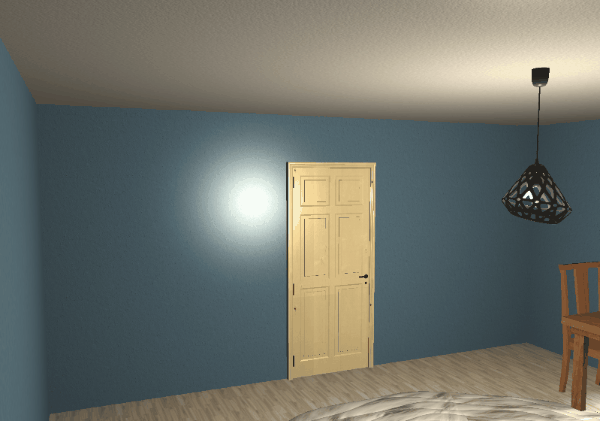

# Real-Time 3D Room Lighting Simulation

An interactive 3D simulation of an illuminated interior implemented in **C++17** and **OpenGL 3.3 Core Profile**. 

The application renders a fully textured room scene featuring dynamic multi-source lighting, real-time (time-based) animations, and an interactive first-person (FPS) camera.



---

## Project Features and Graphics Architecture

- **Phong Lighting Model:** Custom implementation of the lighting model in the fragment shader (Ambient, Diffuse, and Specular components, including distance attenuation).
- **Multiple Light Sources Support:**
  * **Point Light:** A point light simulating a ceiling bulb with non-linear quadratic attenuation.
  * **Spotlight:** A cone light/spotlight with smooth edge attenuation (smooth transition between `innerCutOff` and `outerCutOff` angles).
  * **Dynamic Modes:** Ability to toggle on-the-fly between both light sources, spotlight only, point light only, or completely turned off.
- **Model and Texture Loading:**
  * Parsing geometry and meshes from `.obj` files using the `tinyobjloader` library.
  * 2D texture mapping (`.jpg`) with bilinear filtering and Mipmap chain generation via `stb_image`.
- **Animations and Interaction:**
  * Smooth, framerate-independent door opening and closing animation based on time delta (`deltaTime`) and an offset pivot point (hinge).
  * Continuous rotation of fan blades along their local axis.
- **FPS Camera:** Full freedom of movement in all directions with mouse input support (Pitch/Yaw with angle constraints).

---

## Controls

| Key / Mouse | Action |
| :--- | :--- |
| `W`, `S`, `A`, `D` | Move around the room (forward, backward, left, right) |
| `Mouse movement` | Look around (camera Pitch & Yaw rotation) |
| `E` | Interaction: smooth opening / closing of the door |
| `T` | Lighting mode toggle (Both &rarr; Spotlight &rarr; Point light &rarr; Off) |
| `ESC` | Exit application |

---

## Tech Stack

- **Language:** C++17
- **Graphics API:** OpenGL 3.3 Core Profile
- **Build System:** CMake (with the `FetchContent` module automatically downloading required libraries)
- **Libraries:**
  * [GLFW](https://www.glfw.org/) – OpenGL context window management and input handling.
  * [GLAD](https://glad.dav1d.de/) – OpenGL 3.3 function pointer loader.
  * [GLM](https://github.com/g-truc/glm) – Mathematics library (transformation matrices, vectors, perspective projection).
  * [stb_image](https://github.com/nothings/stb) – Decoding `.jpg` image files.
  * [tinyobjloader](https://github.com/tinyobjloader/tinyobjloader) – Parser for `.obj` files.

---

## Build and Run

### Prerequisites
- A C++ compiler supporting the C++17 standard (MSVC, GCC, or Clang)
- CMake version 3.14 or higher

### Build Instructions

1. Clone the repository:
   ```bash
   git clone https://github.com/biteek/opengl-room-simulation.git
   cd opengl-room-simulation

2. Configure the project using CMake:
   ```bash
   cmake -B build
   ```

3. Build the application:
   ```bash
   cmake --build build --config Release
   ```
   *(CMake will automatically copy the objects/ directory with assets to the output folder of the .exe file)*

4. Run the program:
   * **Windows (Visual Studio):** build/Release/GrafikaKomputerowa.exe (or build/Debug/GrafikaKomputerowa.exe)
   * **Linux / Ninja:** `build/GrafikaKomputerowa`
